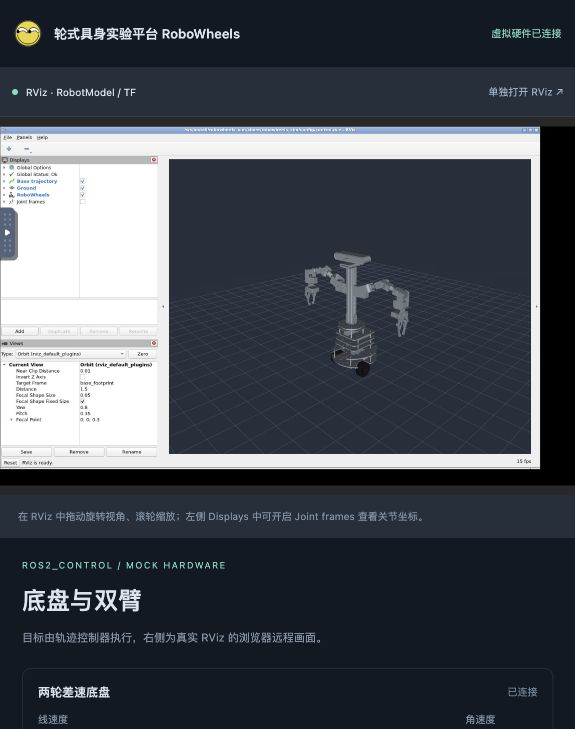

# 轮式具身实验平台 RoboWheels

RoboWheels 是一个两轮差速、双机械臂机器人项目，包含 RDK X5 真机软件、基于机械模型的仿真环境，以及浏览器中的 RViz 控制界面。

项目使用 ROS 2 Humble。机械装配由 STEP 转换为 URDF/SDF 和 STL；在 Mac Docker 中，可以查看机器人模型、驾驶差速底盘、执行双臂关节轨迹，并检查位置反馈与坐标变换。

两套真机的连接关系见 **[RDK X5 与 Orange Pi 3 LTS 接线图](docs/hardware/WIRING.md)**，包含电机、编码器、传感器及未确认的供电项。

## 运行模式

Mac 原生窗口入口：**[XQuartz + VirtualGL 原生 RViz2](docs/simulation/XQUARTZ.md)**。可以直接在 RViz 窗口的控制面板中执行双臂轨迹、驾驶差速底盘并查看位置反馈。

| 模式 | 环境 | 主要能力 | 使用说明 |
|---|---|---|---|
| **XQuartz 原生 RViz** | Mac XQuartz + Docker + VirtualGL | RViz 窗口内的双臂轨迹、底盘驾驶与反馈 | [原生窗口](docs/simulation/XQUARTZ.md) |
| **虚拟硬件与 RViz** | Mac Docker，ROS 2 Humble + ros2_control | 浏览器 RViz、双臂 10 关节轨迹、差速底盘、里程计与反馈 | [控制环境](docs/simulation/ROS2_CONTROL.md) |
| **底盘物理仿真** | Mac Docker，ROS 2 Humble + Gazebo Fortress | STEP 外观模型、底盘运动、重力与简化碰撞、网页三维显示 | [Gazebo 仿真](docs/simulation/README.md) |
| **真机运行** | RDK X5，Ubuntu 22.04 / RDK OS 3.5.0 | 电机与编码器、手柄、Astra RGB、GS130 双目与 IMU | [硬件记录](HARDWARE.md)、[ROS 包说明](ros2_ws/src/robowheels/README.md) |

虚拟硬件模式用于控制链路与运动学验证；需要地面接触和碰撞时使用 Gazebo 模式。真机硬件的实测结论、迁移参数和未确认项以 [HARDWARE.md](HARDWARE.md) 为准。

## 快速开始：浏览器 RViz 与整车控制

需要先安装并启动 Docker Desktop。以下命令均在仓库根目录执行；首次构建会下载 ROS、RViz 和 Gazebo 依赖。

```bash
# 构建基础镜像，再构建并启动虚拟硬件环境
# 基础镜像只需构建，不必同时启动 Gazebo 服务
docker compose -f compose.sim.yaml build
docker compose -f compose.control.yaml up --build -d
```

打开 **[RViz 与底盘/双臂控制面板](http://localhost:18081)**。也可以 [单独打开 RViz](http://localhost:16080/vnc.html?autoconnect=1&resize=scale&reconnect=1)。浏览器中的 RViz 是容器内 RViz 经 noVNC 传输的远程画面。



### 差速底盘

- 按住方向按钮前进、后退或原地转向，松开停车。
- 控制面板获得焦点时，可用 **W/A/S/D** 驾驶，**空格**停车。
- 默认线速度为 **0.12 m/s**，可调至 **0.25 m/s**；角速度上限为 **1 rad/s**。
- 网页显示位姿、速度和左右轮转角；RViz 显示整车运动及绿色行驶轨迹。
- 页面失焦会发送停车指令；控制器另有 **0.5 秒**指令超时停车，按配置的减速度完成停车。

### 双臂轨迹

- 左右臂各有 5 个可动关节：肩部侧摆、肩部俯仰、肘部俯仰、腕部俯仰、腕部旋转。
- 点击“执行示例轨迹”，执行三段、总计 9 秒的小幅轨迹，最后回到 STEP 装配姿态。
- 调整关节目标和执行时长后，点击“执行目标位置”；滑块变化本身不会驱动关节。
- “取消轨迹”取消当前 action 并保持当前位置。底盘驾驶和双臂轨迹可同时执行。

已构建镜像后，再次启动不必重新构建：

```bash
docker compose -f compose.control.yaml up -d

# 查看日志或停止环境
docker compose -f compose.control.yaml logs -f control
docker compose -f compose.control.yaml stop control
```

## Gazebo 底盘物理仿真

```bash
docker compose -f compose.sim.yaml up --build -d
```

打开 **[底盘三维仿真网页](http://localhost:18080)**，使用按钮或 W/A/S/D 控制底盘，也可通过 Foxglove 连接 `ws://localhost:8765` 查看 ROS 数据。

该模式包含重力、轮子接触、简化碰撞体和测试障碍物。机械臂保持固定装配姿态，质量、惯量与摩擦参数仍为估算值。详细操作见 [仿真说明](docs/simulation/README.md)。

两个本地环境使用不同的 ROS 域，可同时运行；端口仅映射到本机回环地址。

| 环境 | ROS_DOMAIN_ID | 网页入口 | 附加入口 |
|---|---|---|---|
| ros2_control 虚拟硬件 | 43 | [localhost:18081](http://localhost:18081) | RViz/noVNC：16080 |
| Gazebo 物理仿真 | 42 | [localhost:18080](http://localhost:18080) | Foxglove Bridge：8765 |

## 控制架构与 ROS 接口

虚拟硬件模式由 `controller_manager` 管理三个控制器：

| 控制器 | 硬件接口 | 职责 |
|---|---|---|
| `arm_controller` | 双臂 10 个关节的 `position` 指令 | 执行 `FollowJointTrajectory`，提供反馈、结果和取消 |
| `base_controller` | 左右轮的 `velocity` 指令 | 将车体速度转换为轮速，从轮位置反馈计算里程计 |
| `joint_state_broadcaster` | 关节 `position` / `velocity` 状态 | 发布模型关节状态，驱动 TF 和 RViz |

双臂使用 `mock_components/GenericSystem` 跟随位置指令；底盘使用独立 GenericSystem，将轮速积分为轮子位置。`diff_drive_controller` 读取位置反馈计算里程计，配置为 `open_loop=false`。这不包含电机力矩、负载、轮胎打滑或碰撞动力学。

| 接口 | 用途 |
|---|---|
| `/cmd_vel` | 底盘车体速度指令，`geometry_msgs/msg/Twist` |
| `/odom` | 底盘里程计 |
| `/arm_controller/follow_joint_trajectory` | 双臂轨迹 action |
| `/arm_controller/controller_state` | 双臂控制器目标、实际值及误差 |
| `/joint_states` | 轮子及双臂关节反馈 |
| `/robot_description` | 当前模式的机器人模型 |
| `/tf`、`/tf_static` | 车体和关节坐标变换 |
| `/base_path` | 虚拟硬件模式的 RViz 行驶轨迹 |

虚拟硬件模式使用 `odom → base_footprint → base_link → 各关节` 坐标链。控制器参数位于 [controllers.yaml](ros2_ws/src/robowheels_sim/config/controllers.yaml)。

## 机械模型与验证

原始机械模型为 `step/robot.STEP`。转换工具完成了零件分组、毫米到米的单位转换、装配姿态校正，以及从舵机轮毂圆柱面提取关节轴线。

| 模型 | 用途 |
|---|---|
| [robot.urdf](ros2_ws/src/robowheels_description/urdf/robot.urdf) / [robot.sdf](ros2_ws/src/robowheels_description/urdf/robot.sdf) | Gazebo 底盘仿真，双臂固定 |
| [robot_control.urdf](ros2_ws/src/robowheels_description/urdf/robot_control.urdf) | 双臂可动模型与整车 ros2_control 虚拟硬件 |

已完成的软件验证包括：

- 拆分后的零位网格与原装配几何外包络一致，机械臂零件无遗漏或重复分配。
- 关节轴向归一化，成对轮毂轴线一致；独立正运动学计算与 TF 一致。
- 双臂轨迹执行、位置插值反馈、目标到位和取消后的保持状态。
- 差速底盘前进、转向、轮位置与里程计一致性、限速和超时停车。
- 底盘驾驶与双臂轨迹并行运行，以及网页按钮控制。
- Gazebo 模式的实际车体位移、姿态稳定性及障碍物碰撞。

这些检查验证的是模型与软件链路。双臂零位目前定义为 STEP 装配姿态，**±0.65 rad 为虚拟演示限位**，尚未替代实车的舵机方向、零位和限位标定。夹爪保持固定，尚未接入 MoveIt 避碰规划；相机和 IMU 在仿真中尚无传感器数据输出。

复现控制环境检查：

```bash
# 装配几何检查需要本机 Python 与 NumPy
python3 tools/validate_control_geometry.py

# 环境启动后，执行双臂和底盘检查（会驱动虚拟机器人）
docker compose -f compose.control.yaml cp tools/validate_control.py control:/tmp/validate_control.py
docker compose -f compose.control.yaml exec control bash -lc 'source /ws/install/setup.bash; python3 /tmp/validate_control.py'
docker compose -f compose.control.yaml cp tools/validate_control_base.py control:/tmp/validate_control_base.py
docker compose -f compose.control.yaml exec control bash -lc 'source /ws/install/setup.bash; python3 /tmp/validate_control_base.py'
```

重建 CAD 模型、Gazebo 检查及参数说明见 [仿真文档](docs/simulation/README.md) 和 [控制文档](docs/simulation/ROS2_CONTROL.md)。

## RDK X5 真机

### 硬件与当前状态

| 子系统 | 硬件 / 软件 | 当前记录 |
|---|---|---|
| 底盘 | TT 电机 ×2、AT8236、正交编码器 ×2；`motor_driver` | 节点已验证，电机/编码器映射及里程计参数仍需实车核对 |
| 手柄 | DragonRise；`joy` + `teleop_twist_joy` | 已验证，发布 `/cmd_vel` |
| RGB 相机 | Orbbec Astra Pro USB；`astra_rgb_node` | UVC RGB 已出图，约 30 fps |
| 双目与 IMU | GS130WI MIPI；`gs130_vio_bridge` | 双目与 IMU 数据已发布，预留 VIO 接入 |
| 立体点云 | CPU SGBM；`stereo_pointcloud_node` | 实测约 3.7 Hz；BPU 路线可选 `hobot_stereonet` |
| 双臂舵机 | LewanSoul LX-15D / LD-27MG；UART1 | 真机通信排查暂停，尚未接入本文的 ros2_control 虚拟接口 |

### 原生启动

```bash
source /opt/ros/humble/setup.bash
source /opt/tros/humble/setup.bash

# 在仓库根目录进入工作区，只构建真机包
cd ros2_ws
colcon build --symlink-install --packages-select robowheels
source install/setup.bash

ros2 launch robowheels bringup.launch.py
```

按需单独启动：

```bash
ros2 launch robowheels motor.launch.py
ros2 launch robowheels joy.launch.py
ros2 launch robowheels gs130.launch.py
ros2 launch robowheels astra_camera.launch.py use_sdk:=false
```

手柄操作：按住 RB（键 5）使能，左摇杆前后控制行进，右摇杆左右控制转向。

### 真机 Docker

以下镜像包含 RDK 的 TROS 与板载设备依赖，应在 RDK X5 上使用；Mac 仿真使用前面的独立镜像。

```bash
docker build -t robowheels:rdkx5 .
docker run -it --rm --privileged --network host \
    -v /dev:/dev -v /sys:/sys:rw \
    robowheels:rdkx5 ros2 launch robowheels bringup.launch.py
```

### 接线与调试

| 功能 | 40PIN BOARD 脚号 / 接口 |
|---|---|
| 电机 AIN1 / AIN2 / BIN1 / BIN2 | 27 / 29 / 31 / 33 |
| 编码器 E1A / E1B / E2A / E2B | 11 / 13 / 15 / 16 |
| 舵机 UART1 TX / RX | 8 / 10，`/dev/ttyS1` |
| GS130WI 同步线 LPWM | 37 |
| 手柄 / Astra Pro | USB |

8/10 脚是 UART1。当前电机使用软件 PWM；首次运行前需用 `tools/motor_test.py` 和 `tools/encoder_test.py` 核对电机/编码器归属、转向和里程计标定。

Astra Pro 的 IR/深度仍有 SDK 与固件兼容问题；VIO 算法尚需按鱼眼模型配置。感知 RViz、完整话题、标定与排查步骤见 [真机包说明](ros2_ws/src/robowheels/README.md) 和 [HARDWARE.md](HARDWARE.md)。

真机控制约束：

- 电机引脚启动时先置 `OUTPUT LOW`；退出时只置 LOW，禁止调用 `GPIO.cleanup()`，避免 AT8236 输入悬空。
- `/cmd_vel` 500 ms 无更新自动停车。
- 参数统一放在 `config/*.yaml`，硬件映射与标定结果同步记录到 `HARDWARE.md`。

## 目录结构

```text
.
├── README.md
├── HARDWARE.md                   # 真机实测、接线与排查记录
├── Dockerfile / compose.yaml     # RDK X5 真机环境
├── compose.sim.yaml              # Gazebo 底盘物理仿真
├── compose.control.yaml          # ros2_control + 浏览器 RViz
├── docker/
│   ├── cad.Dockerfile            # STEP 转换工具链
│   └── sim/                      # 仿真与虚拟硬件镜像、入口脚本
├── docs/simulation/              # 仿真及控制环境详细说明
├── step/                        # 本地 STEP 原件；Git 中只保留说明
├── tools/
│   ├── cad/                      # CAD 检查与模型导出
│   ├── validate_control*.py      # 装配、轨迹和底盘验证
│   └── ...                       # 真机调试、Gazebo 检查工具
├── third_party/hobot_gpio/       # GPIO 源码与上游声明
├── pyproject.toml / uv.lock      # 真机 Python 依赖
└── ros2_ws/src/
    ├── robowheels/               # 真机节点、launch、配置与 udev
    ├── robowheels_description/   # URDF/SDF、STL 与模型参数报告
    └── robowheels_sim/           # Gazebo、控制器、RViz 与本地网页
```

## 仓库文件约定

运行必需的 STL、URDF/SDF、网页图标、前端依赖及许可证随仓库保留，克隆后无需原始 STEP 即可运行仿真。

原始 `step/robot.STEP` 仅用于重建机械模型，保留在本机并由 Git 忽略，来源与校验和见 [STEP 说明](step/README.md)。缓存、构建产物、录包、本地配置和 `.local/` 中的检查记录不提交；忽略规则见 [.gitignore](.gitignore) 和 [.dockerignore](.dockerignore)。
