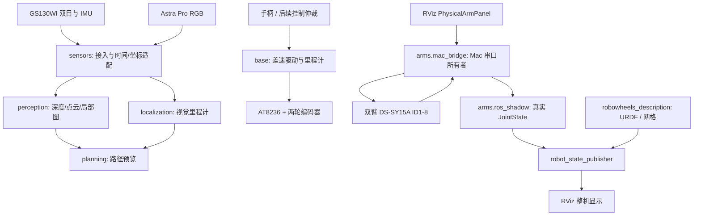

# RoboWheels 架构

平台分为上下两部分，共用机器人描述与坐标树：

- 底部：两轮差速底盘，AT8236 + 编码器；GS130WI双目与IMU用于深度、定位、导航。
- 顶部：左右各4个DS-SY15A总线舵机；Astra Pro提供上层RGB视觉，深度仍待验证。

## 运行模块

| 模块 | 源码位置（robowheels包内） | 职责 |
|---|---|---|
| 底盘 | `base/` | 电机PWM、编码器、差速运动学、里程计和指令超时停车 |
| 双臂 | `arms/` | 德晟协议、Mac独占串口、受限步进、实际反馈到ROS |
| 传感器接入 | `sensors/` | GS130WI图像/IMU适配，Astra RGB及Mac图像桥 |
| 感知 | `perception/` | 双目深度、点云、局部占据图和ESDF |
| 定位 | `localization/` | ORB视觉里程计，预留相机/IMU融合 |
| 规划 | `planning/` | 栅格、障碍膨胀和路径预览；当前不直接驱动底盘 |

子系统位于同一个Python ROS包中，便于目前迭代；代码按职责分目录，避免把平台绑定
写进通用算法。以后可按部署需求拆成独立ROS包，接口保持一致。
旧的 `robowheels.motor_driver` 等转发模块已移除，直接使用
`robowheels.base.motor_driver` 等规范路径。ROS命令行节点名称保持不变。

当前路径预览、底盘遥控和双臂步进各自验证，尚未实现整机任务规划或移动操作协调。
将来规划接入速度/轨迹输出时，应保留单一设备所有者及明确的控制权仲裁。

## ROS包与部署边界

| 包/入口 | 运行环境 | 说明 |
|---|---|---|
| `robowheels` | RDK X5 / Mac原生 / Docker按模块使用 | 实体运行节点与算法 |
| `robowheels_description` | 共用 | STEP导出的网格、URDF/SDF与模型报告 |
| `robowheels_rviz_plugins` | Docker RViz | 虚拟轨迹面板、实体八关节反馈/小步面板 |
| `robowheels_sim` | Docker | Gazebo物理仿真、mock ros2_control和仿真网页 |
| `scripts/mac_physical_arms.py` | Mac | 实体双臂启动/停止，不直接包含协议实现 |
| `scripts/rdk_debug.py` | Mac | X5只读遥测中继，主机地址来自参数/环境/本机配置 |
| `scripts/xquartz.py` | Mac，可选 | 原生窗口显示；当前实体模式使用noVNC |

| 模式 | ROS域 | 浏览器端口 | 是否连接实体执行器 |
|---|---:|---:|---|
| Gazebo | 42 | 18080 | 否 |
| 虚拟ros2_control | 43 | 18081 / noVNC 16080 | 否 |
| 实体双臂反馈与步进 | 44 | noVNC 16082 | 是，Mac USB串口 |
| X5遥测 | 0 | noVNC 16081 | 只读转发；X5节点自行管理硬件 |

实体双臂模式不运行mock控制器，`/joint_states`只有真实反馈发布者；
仿真模式不向Mac串口转发指令。当前不同域尚未统一为整机导航+操作系统。

## 配置和标定

- 通用运行参数放在ROS包 `config/`；关节ID、ROS名称与模板在 `config/arms/`。
- 本机端口和本机器人软件零位放 `.local/config/arms/`，不进Git或Docker镜像。
- 双臂软件零位参考“双臂放下”，仅表示原始位置偏移。角度比例、正方向、机械限位
  仍需标定，不可直接用于自动回零、IK或碰撞规划。
- `robot_control.urdf`的10关节用于原虚拟演示；实体显示模型在运行时派生，
  按用户要求固定两侧最后的腕旋转自由度，剩余8个关节映射到实体。

## 后续开发顺序

1. 完成八关节方向、角度比例和机械限位校准，复查ID3历史异常。
2. 将Astra RGB桥接纳入统一的实体启动模式，并补充相机内参与安装外参。
3. 复核底盘里程计与双目/IMU标定，完善定位质量及时间同步诊断。
4. 定义整机TF、控制权与故障处理，再接入路径执行或双臂轨迹控制。

详细运行步骤：
[实体双臂](hardware/MAC_ROS_ARMS.md)、[USB相机与舵机](hardware/MAC_USB_DEBUG.md)、
[X5导航](navigation/RDK_X5_NAVIGATION.md)、[虚拟控制](simulation/ROS2_CONTROL.md)。
