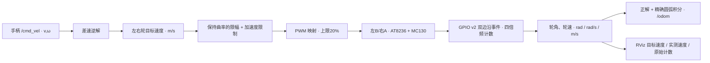

# STEP / MC130 差速底盘模型与标定

## 已确认的模型参数

| 参数 | 当前值 | 依据 |
|---|---:|---|
| 轮径 D | 0.0664 m | STEP 转换记录 |
| 轮半径 R | 0.0332 m | STEP、URDF、仿真 controllers.yaml 一致 |
| 轮距 B（两轮中心距） | 0.15631239107433037 m | 仿真配置；URDF 两轮 y=±0.0781561955 |
| 轮周长 C | 0.20860175219836227 m | πD |
| 电机 | MC130，1:48 | 用户最终确认 |
| 编码器分辨率 N | 左右均 2496 ticks/输出轴圈 | MC130 手册第 8 页：13×48×4 |
| 每米计数 | 左右均 11965.383673414783 ticks/m | N/C |
| 每计数距离 | 约 0.0835744 mm | C/N |
| 编码器 VCC | 3.3V | 用户最终确认；手册允许 3.3–5V |

之前曾误报为 1:90，已按用户最新确认修正。1:90 的 4680 ticks/圈不用于当前配置；手工一圈得到的约 2500 计数只作一致性检查，不覆盖手册分辨率。

几何源在 `tools/cad/model_config.json`、`robowheels_description/urdf/robot_control.urdf` 与 `robowheels_sim/config/controllers.yaml`。真机配置为 `robowheels/config/motor.yaml`；`tools/validation/validate_drive_model.py` 会校验三者的 R/B 和编码器单位换算。

## 运动学与控制链

坐标约定：x 向前，y 向左，绕 z 逆时针为正；左右轮正转都表示推动整车前进。关节名与仿真保持 `left_wheel_joint`、`right_wheel_joint`，帧使用 `odom` 和 `base_footprint`。



逆解：

```text
v_left  = v - B*ω/2
v_right = v + B*ω/2
ω_left  = v_left/R
ω_right = v_right/R
```

正解与编码器换算：

```text
v = (v_right + v_left)/2
ω = (v_right - v_left)/B
Δφ_i = 2π*Δticks_i/N
Δs_i = R*Δφ_i
v_i = Δs_i/Δt
```

`differential_drive.py` 实现正逆解、保持曲率的轮速限幅和 SE(2) 圆弧积分。混合前进与转向时，如果外侧轮超过 0.3 m/s 目标上限，会同比缩小两轮目标，保持转弯比例。轮速变化上限 0.5 m/s²；明确的停车和指令超时立即停机，不等待减速斜坡。

例：直行 v=0.3、ω=0 时，两轮目标均 0.3 m/s，即约 9.03614 rad/s。两轮各累计 2496 个正向计数，模型计算的行驶距离是 0.208602 m、轮角各 2π rad。

## 硬件方向映射

- 右轮 A：IN2/BOARD29 前进，IN1/BOARD27 后退，E2=15/16。
- 左轮 B：IN1/BOARD31 前进，IN2/BOARD33 后退，E1=11/13。
- GPIO 事件模块内部计数与轮子正向一致；兼容的 `/rdk_debug/encoder_counts` 保留原始电气符号和 `[E1,E2]` 顺序。

## 本次标定过程与精度边界

最初 sysfs 轮询在手转五圈测试中出现约 5% 左右差异，复测同一轮又变化约 11%，因此这些值作废，没有用来校准 N。

改为 Linux GPIO v2 内核边沿事件队列后，按内核时间戳合并事件，并使用逐引脚序号诊断丢失；保留 5ms 重排窗口，避免多核下全局序号到达乱序被误判为丢失。无硬件回归测试见 `tools/validation/validate_encoder_events.py`。手转单圈记录：

| 轮子 | 第一次 | 重复核对 | 软件诊断 |
|---|---:|---:|---|
| 左 | 2565 | 2508 | 非法跳变 0，队列丢失 0 |
| 右 | 2561 | 2540 | 非法跳变 0，队列丢失 0 |

人工标记回位仍有约 0.8–2.2% 的重复差异。采用厂家 2496 ticks/圈建立理论换算，不把人工均值当成精确硬件分辨率。GPIO 事件序号可以报告内核队列丢失，但不能证明电气信号或进入内核前的边沿永远不丢；仍需实地距离复核。

当前属于 **STEP 几何 + 厂家分辨率的参数化标定**。尚未用卷尺长距离行驶去拟合有效滚动半径、左右轮半径差和有效轮距。载荷、轮胎压缩、打滑、齿隙不包含在刚性几何模型中。

## 真机运行验证

已在相机、点云恢复运行的状态下完成短时前进/后退验证：两轮方向正确，轮角与 2496 ticks/圈换算一致，逐引脚事件队列丢失为 0，0.5 秒指令超时后四路 PWM 均禁用并归零。手柄恢复前已检查 RB 松开且摇杆回中，并已恢复控制；仍保留 0.3 m/s 指令与 20% PWM 上限。

## 控制与测试边界

- 当前使用开环 PWM 映射，`use_pid: false`；目标轮速、实际轮速与里程计已按同一套模型换算。没有声称已完成电机动力学辨识或地面 PI 调参。
- 线速度指令和单轮目标限 0.3 m/s，PWM 限 20%；实际速度是否跟随目标需要载荷下验证，不能仅凭指令上限保证实际车速。
- MC130 手册第 5 页标注电机额定 6V、建议 3–9V。此前电池标称 10.8V；用户在本轮验证前已确认电机 VM 降压到不超过 9V。PWM 限幅不是电源稳压。编码器供电则独立要求符合 3.3V GPIO 接口，用户已确认用 3.3V。
- 对应配置状态为 `mc130_48_datasheet_step_geometry_ground_check_pending`，保留地面检查待办。

验证入口：

```bash
# Mac / 本地：无电机动作，验证模型与 STEP/仿真一致
python3 tools/validation/validate_drive_model.py

# X5：手工一圈采样，只读计数；先暂停手柄、确保电机停机
python3 tools/hardware/base/calibrate_encoder_turns.py begin left --turns 1
python3 tools/hardware/base/calibrate_encoder_turns.py finish left
```

模型验证覆盖：正逆解往返、直行/倒车/原地旋转、保持曲率的限幅、圆弧积分、一圈到 2π rad 与周长的换算。原始测量和运行验证报告在被忽略的 `.local/validation/` 中。
