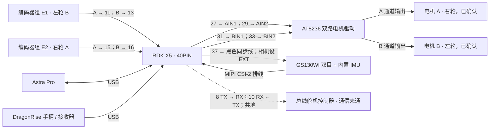
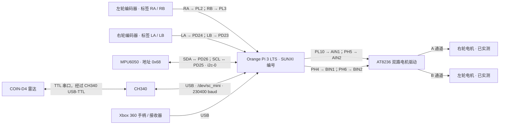
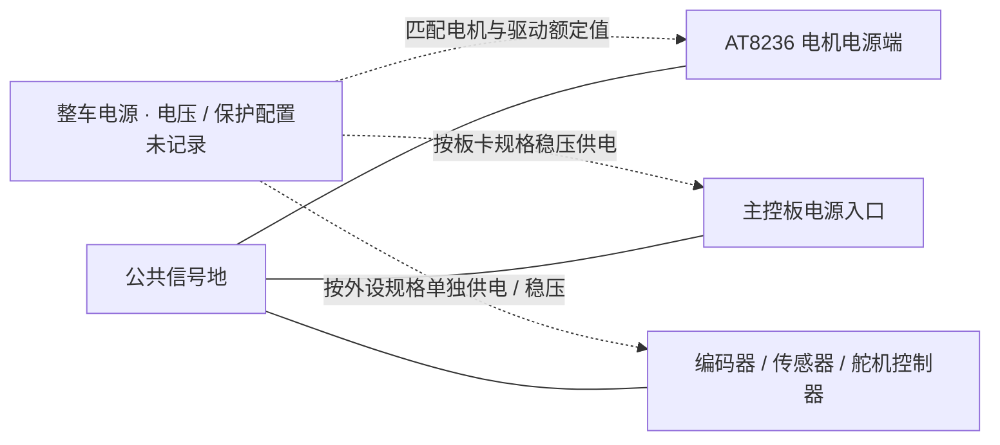

# RoboWheels 两平台接线图

依据本地分支快照整理：`main`（`f23f305`）与 `origin/orangepi3lts`（`3d81ccd`）。未联网刷新远端；图示是仓库资料对应的接线关系，不代表重新实测。左右轮均按机器人前进方向定义。

## RDK X5 版本（main）

引脚编号使用 **40PIN 排针的物理脚号（BOARD）**，不能与 sysfs GPIO 编号混用。

### 底盘逐线接线表

| 外设端子 | X5 BOARD 物理脚 | sysfs GPIO | 状态 |
|---|---:|---:|---|
| AT8236 AIN1 | 27 | 355 | 引脚记录已确认 |
| AT8236 AIN2 | 29 | 399 | 引脚记录已确认 |
| AT8236 BIN1 | 31 | 400 | 引脚记录已确认 |
| AT8236 BIN2 | 33 | 357 | 引脚记录已确认 |
| 编码器 E1 A | 11 | 380 | E1 对应电机 B / 左轮 |
| 编码器 E1 B | 13 | 379 | 同上 |
| 编码器 E2 A | 15 | 388 | E2 对应电机 A / 右轮 |
| 编码器 E2 B | 16 | 382 | 同上 |
| GS130WI 黑色同步线 | 37 | 401 | 使用 LPWM 触发，不作为普通 GPIO 驱动 |
| 舵机控制器 RX | 8（UART1 TX） | 383 | `/dev/ttyS1`，3.3V TTL，通信未通 |
| 舵机控制器 TX | 10（UART1 RX） | 384 | UART 收发交叉连接 |
| 外设信号 GND | 39（GND） | — | 共地连接；39 不是 GPIO |

2026-11-08 已通过用户观察与编码器确认：A=右轮、B=左轮、E1=左轮、E2=右轮；A 的 IN2 PWM 为整车前进，B 的 IN1 PWM 为整车前进。配置与手柄控制见 [TELEOP_X5.md](TELEOP_X5.md)。仓库未记录电机线色。

补充：已根据厂家手册与原理图核对 AT8236 的供电、H1/H2 和六针电机接口。用户补充使用 10.8V 电池接 VIN 且开关开启；MC130 手册说明配套反向六针线可连接塔克驱动板，不能仅凭之前列举的信号名称认定线序不兼容。最新确认编码器使用 3.3V，以匹配 X5 GPIO；MC130 本体支持 3.3–5V。**逐针连接与故障判断见 [AT8236 资料核对](AT8236_REVIEW.md)**。H1 实际针序为 BIN2、BIN1、AIN1、AIN2；H2 前四针为 E2A、E2B、E1A、E1B。VIN 应从指定输入接口接入 5.5–15V 并开启开关，5V/3V3 是输出。

UART1 的实测记录提示 RS485 模式配置可能影响应答，舵机链路暂停排查。此处虚线表示待调通的接线，不能据此认为真机双臂已可控制。USB-TTL 是备选方案，不与板载 UART 同时连接同一组收发线。

GS130WI 的 IMU 随相机接口工作，无需另接 MPU6050。Astra、手柄走 USB。主分支记录已移除 Orange Pi 的 COIN-D4 雷达和 MPU6050。

## Orange Pi 3 LTS 版本（orangepi3lts）

下面使用 **SUNXI 信号名**（例如 PH6、PL10），不是排针物理脚号。仓库没有完整的排针物理脚号对照，因此不猜测脚位；接线时需按对应板卡丝印或引脚表找到这些信号。wPi 号仅列出历史实测记录中已有的值。

### 底盘与 IMU 逐线接线表

| 外设端子 | Orange Pi SUNXI 信号 | 已记录的 wPi 号 | 实测用途 |
|---|---|---:|---|
| AT8236 AIN1 | PL10 | 8 | 右轮反向 PWM 输入 |
| AT8236 AIN2 | PH5 | 11 | 右轮正向 PWM 输入 |
| AT8236 BIN1 | PH4 | 14 | 左轮反向 PWM 输入 |
| AT8236 BIN2 | PH6 | 12 | 左轮正向 PWM 输入 |
| 左轮编码器 RA | PL2 | — | 左轮 A 相 |
| 左轮编码器 RB | PL3 | — | 左轮 B 相 |
| 右轮编码器 LA | PD24 | — | 右轮 A 相 |
| 右轮编码器 LB | PD23 | — | 右轮 B 相 |
| MPU6050 SDA | PD26（SDA.0） | — | i2c-0，ALT2 |
| MPU6050 SCL | PD25（SCL.0） | — | i2c-0，ALT2 |
| MPU6050 / 驱动 / 编码器 GND | 板卡 GND | — | 共地；物理脚号待核实 |

**不要按 LA/LB 字面将它们接成左轮。** 分支已实测左轮是 RA/RB、右轮是 LA/LB；右轮前进计数原始符号为负，配置中通过 `right_encoder_inverted: true` 修正。

雷达使用 CH340 USB-TTL，不使用板载串口：原则上雷达 TX 接适配器 RX、需要接收命令时雷达 RX 接适配器 TX，并共地。仓库没有记录雷达线色、连接器针序及供电电压，不能据此直接确定其插头接法。串口设备曾为 `/dev/ttyUSB0`，稳定软链为 `/dev/sc_mini`，波特率 230400。

该分支未提供 GS130WI、Astra 或双臂舵机控制器接线依据，不将主分支的接线直接套用到此版本。

## 两版本共用的供电关系（示意，电压未定）

虚线仅表达需要供电的关系，不代表已有确定的电压或电源分配方案。仓库未给出电池电压、实物电源接法、编码器型号及输出电平、MPU6050 模块型号及 VCC、舵机电源电压和线色；AT8236 模块本身的接口针序和 5.5–15V 输入要求已由厂家资料补齐（见上述核对文档），实际接法仍需结合实物确认。电机和舵机供电不能由 GPIO 信号脚承担；编码器回传电平需与主控 GPIO 兼容，不能仅凭供电电压推断输出电平。

Orange Pi 历史版本使用 200Hz 软件 PWM、两路 IN2 PWM 为前进。X5 当前使用 200Hz 硬件 PWM，A 的 IN2、B 的 IN1 为整车前进；IN1/IN2 全 LOW 为滑行。AT8236 在项目记录中没有 STBY。启动与退出应保持电机控制脚为输出 LOW；已有 0.5s 指令超时停车逻辑。

## 依据与待补齐项

| 内容 | 分支内依据 |
|---|---|
| X5 物理脚、sysfs 对照、UART、相机、USB 外设 | `main:HARDWARE.md` |
| X5 当前默认轮侧映射与控制引脚 | `main:ros2_ws/src/robowheels/config/motor.yaml` |
| Orange Pi 实测电机、编码器、I2C、雷达、手柄 | `origin/orangepi3lts:HARDWARE.md` |
| Orange Pi 引脚及右轮编码器反号 | `origin/orangepi3lts:ros2_ws/src/robowheels/config/motor.yaml` |
| MPU6050 总线与地址 | `origin/orangepi3lts:ros2_ws/src/robowheels/config/control.yaml`、`robowheels/imu_publisher.py` |

下一步补齐实物排针正反面方向、Orange Pi 物理脚号、各模块电源与插头针序，以及 X5 电机/编码器轮侧对应关系后，才能形成可逐针照接的完整施工图。
