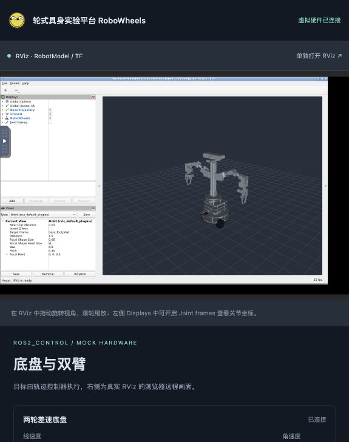

# ros2_control 虚拟硬件与浏览器 RViz

这个模式使用真正的 ROS 2 `controller_manager`、`mock_components/GenericSystem`、`joint_state_broadcaster`、`joint_trajectory_controller` 与 `diff_drive_controller`。浏览器里的 RViz 是容器内 RViz 的 noVNC 远程画面，模型运动来自 `/joint_states`、里程计与 TF；网页通过 `FollowJointTrajectory` action 提交双臂轨迹，通过 `/cmd_vel` 驾驶差速底盘。

## 运行

在仓库根目录执行。首先确保基础仿真镜像已存在，再构建控制镜像：

```bash
docker compose -f compose.sim.yaml build
docker compose -f compose.control.yaml up --build -d
```

如果镜像已构建：

```bash
docker compose -f compose.control.yaml up -d
```

- [RViz 与轨迹控制面板](http://localhost:18081)
- [单独打开 RViz](http://localhost:16080/vnc.html?autoconnect=1&resize=scale&reconnect=1)

点击“执行示例轨迹”执行双臂小幅、三段、9 秒的轨迹，最后返回 STEP 装配姿态。也可以调整 10 个关节目标和时长，再点击“执行目标位置”。“取消轨迹”取消当前 action 并保持当前位置；修改滑块本身不会直接驱动关节。

“两轮差速底盘”区域支持按住方向按钮前进、后退及原地转向；控制面板获得焦点时也可用 W/A/S/D，空格停车。松开按钮、页面失焦或关闭页面会发送零速度；控制器还有 0.5 秒指令超时停车，停车按配置的减速度完成。默认线速度 0.12 m/s，可调至 0.25 m/s，角速度限幅 1 rad/s。双臂轨迹和底盘驾驶可同时执行，各自占用不同的硬件接口。

RViz 使用 `odom` 固定坐标系，视角跟随 `base_footprint`，绿色 `Base trajectory` 显示行驶轨迹。底盘和双臂会作为完整模型一起移动，轮子转角由虚拟硬件的位置反馈驱动。



RViz 中可拖动旋转、滚轮缩放；在 Displays 面板勾选 `Joint frames` 可以查看关节坐标系。若浏览器窗口较窄，推荐单独打开 RViz 查看大画面。

控制模式使用 `ROS_DOMAIN_ID=43`，原底盘 Gazebo 模式使用 42，两个模式可同时运行，各自发布自己的机器人描述、关节状态和 TF。夹爪保持固定形状。本模式不连接 RDK X5、GPIO、串口或实际舵机。

## 关节和接口

左右臂各有 5 个位置控制关节：肩部侧摆、肩部俯仰、肘部俯仰、腕部俯仰、腕部旋转。命名为 `right_*`、`left_*`，关节顺序见 `ros2_ws/src/robowheels_sim/config/controllers.yaml`。

| 接口 | 用途 |
|---|---|
| `/arm_controller/follow_joint_trajectory` | 轨迹 action，含目标接受、反馈、结果、取消 |
| `/cmd_vel` | 底盘 Twist 指令，差速控制器转换为左右轮速度 |
| `/odom` | 从虚拟轮子位置反馈计算的底盘里程计 |
| `/base_path` | RViz 行驶轨迹 |
| `/joint_states` | 虚拟硬件关节位置、速度反馈 |
| `/arm_controller/controller_state` | 控制器目标、实际值及误差 |
| `/robot_description` | 可动 URDF，RViz 和 robot_state_publisher 共用 |
| `/tf`、`/tf_static` | 机器人关节坐标变换 |

`GenericSystem` 按命令生成位置反馈，适合验证控制链路与运动学，不模拟舵机延迟、力矩、负载或机械接触。网页的关节位置范围为 ±0.65 rad，这是虚拟演示限位，尚未按实车标定；零位是 STEP 文件的装配姿态。示例轨迹不等同于避碰规划，尚未接入 MoveIt。

双臂使用位置指令虚拟硬件，底盘使用另一组启用 `calculate_dynamics` 的 GenericSystem：速度指令积分为轮子位置，再由 `diff_drive_controller` 闭环读取位置反馈计算里程计（`open_loop=false`）。这里的积分不代表力学仿真；该 RViz 模式没有地面碰撞和轮胎打滑模型，需要接触物理时使用原 Gazebo 模式。轮胎半径 0.0332 m、轮距约 0.156312 m，取自 CAD 模型。

## 模型来源与检查

`tools/cad/export_control_robot.py` 从原 STEP 提取圆柱轮毂的轴线，划分 10 个运动连杆和固定肩部舵机外壳，生成 `robot_control.urdf` 与分段 STL。原底盘用 `robot.urdf` 保留。

已记录：

- [模型分组、轴线与零位定义](../../ros2_ws/src/robowheels_description/config/control_model_report.json)
- 零位装配、关节反馈与底盘检查脚本位于 `tools/validate_control*.py`
- 本机验证记录位于 `.local/validation/`，不提交到 Git

零位检查将拆分后的网格还原到整车坐标，与原整臂网格比较外包络；同时检查零件分配无遗漏/重复、轴向归一化以及成对轮毂轴线的一致性。控制检查通过独立正运动学计算与 TF 对比、实际 action 成功结果、位置插值反馈及取消后的保持状态进行验证。这些检查证明软件模型内部的一致性，仍需将连杆归属、实际舵机转向、零位和限位与真机逐项核对。

## 复现检查

```bash
python3 tools/validate_control_geometry.py
docker compose -f compose.control.yaml cp tools/validate_control.py control:/tmp/validate_control.py
docker compose -f compose.control.yaml exec control bash -lc 'source /ws/install/setup.bash; python3 /tmp/validate_control.py'
docker compose -f compose.control.yaml exec control bash -lc 'source /ws/install/setup.bash; ros2 control list_controllers'
docker compose -f compose.control.yaml exec control bash -lc 'source /ws/install/setup.bash; ros2 control list_hardware_components'
docker compose -f compose.control.yaml cp tools/validate_control_base.py control:/tmp/validate_control_base.py
docker compose -f compose.control.yaml exec control bash -lc 'source /ws/install/setup.bash; python3 /tmp/validate_control_base.py'
```

重建可动模型后，重新构建控制镜像：

```bash
docker run --rm -v "$PWD:/work" robowheels:cad tools/cad/export_control_robot.py
docker compose -f compose.control.yaml up --build -d
```

停止控制环境：

```bash
docker compose -f compose.control.yaml stop control
```

RViz/noVNC 依赖 Mac Docker 内的软件渲染，复杂模型交互帧率会受分配给 Docker 的 CPU 资源影响。
